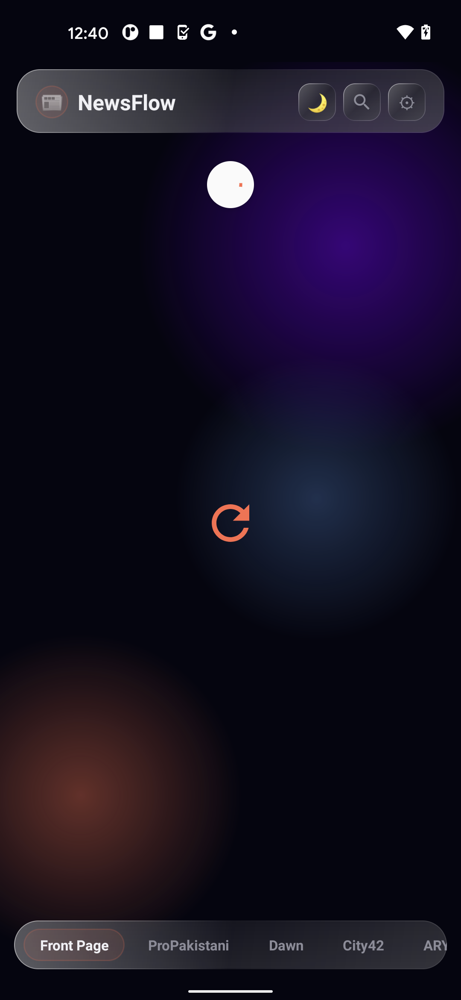
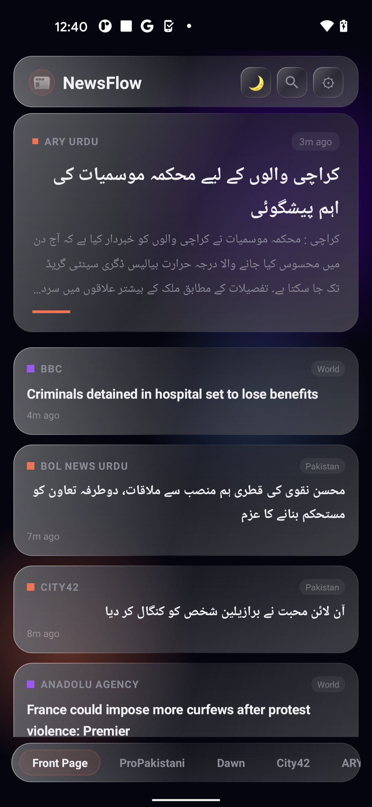
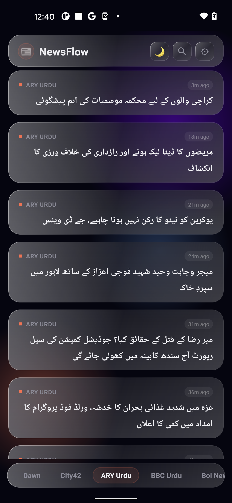
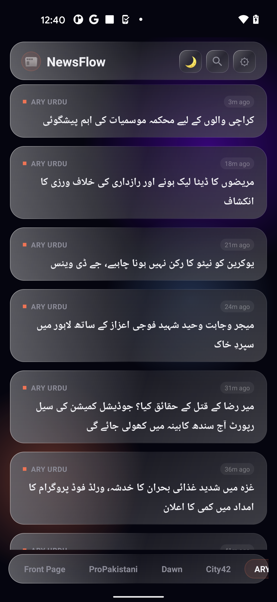
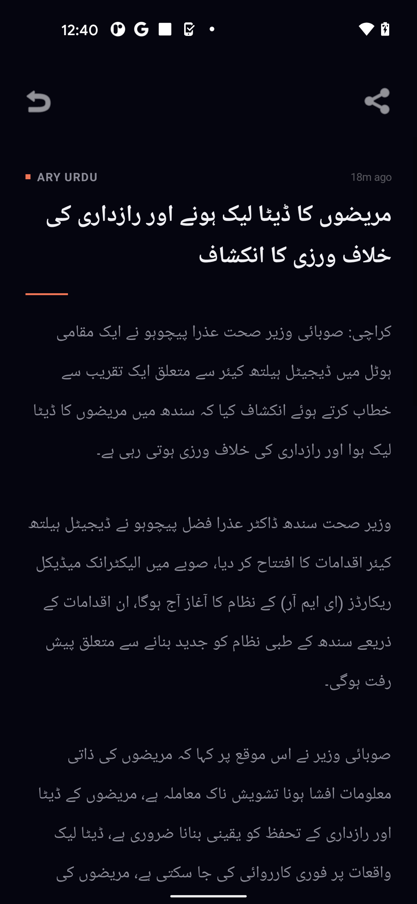
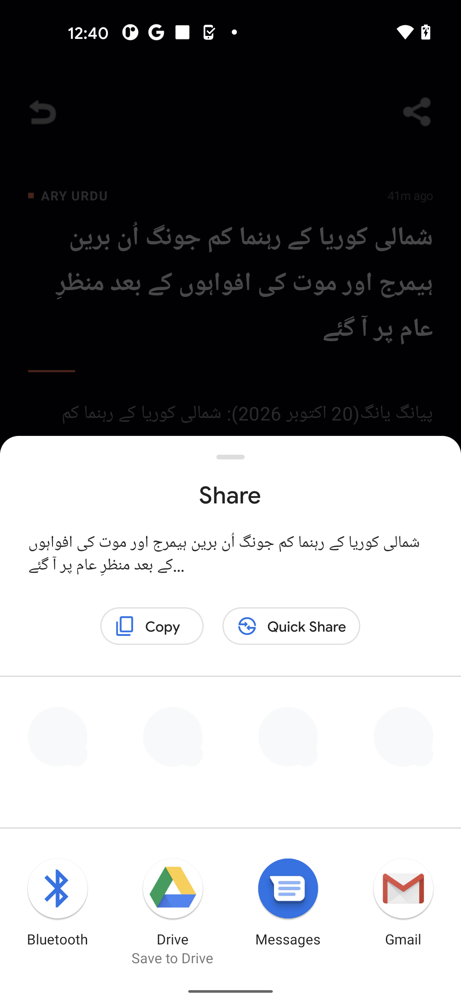
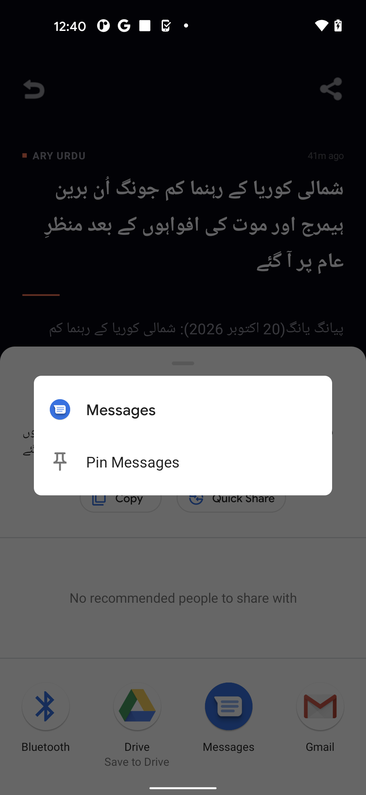
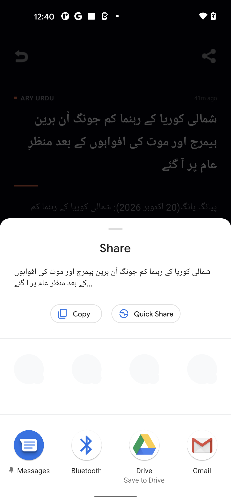

# NewsFlow — Glassmorphic News Aggregator for Android

<div align="center">

-3DDC84?style=for-the-badge&logo=android&logoColor=white)


-success?style=for-the-badge&logo=firebase&logoColor=white)

[](https://wa.me/923171616345?text=Hi%20letmese%2C%20I%20am%20interested%20in%20your%20NewsFlow%20Android%20app.)

### *Real-Time News Aggregator Featuring Glassmorphic Home Screen Widgets, Multi-Source RSS Ingestion, and Full Bilingual Urdu/English Typography*

</div>

---

## 📱 Live App Screenshots (Firebase Test Lab Robo Run)

<div align="center">
  
  
  
  
</div>

<div align="center">
  
  
  
  
</div>

---

## 📖 Overview

**NewsFlow** is a native Android news reader engineered with **Kotlin** and **Jetpack Compose**. Designed for rapid reading and zero-bloat updates, NewsFlow aggregates feeds across national and international outlets with offline article caching, smart category filtering, and transparent glassmorphic Android home screen widgets.

---

## ✨ Features & Architecture

- 📰 **Multi-Source RSS Engine:** High-performance XML/RSS parser ingesting live feeds from top news publishers (Dawn, ProPakistani, BBC Urdu, Dunya, Bol News, City42, etc.).
- 🪟 **Glassmorphic Home Screen Widgets:** Live updating transparent desktop widgets with customizable opacity, blur, and source switching right from your phone's launcher.
- 🌐 **Bilingual Typography & RTL Support:** Native support for English and Nastaliq Urdu rendering with proper Right-to-Left (RTL) text metrics.
- ⚡ **Offline Reading & Fast Caching:** Automatically caches recent stories for offline reading during commutes or low-connectivity areas.
- 🎨 **Material 3 Design:** Dynamic color palettes, smooth scroll fling physics, and dark mode theme engine.
- 🧪 **Automated Cloud QA:** Fully verified via Google Firebase Test Lab Robo test crawler on physical Google Pixel devices.

---

## 🚀 Building from Source

### Prerequisites
* Android Studio (2024+) or Gradle 8.5+
* Android SDK 35
* JDK 17

### Build Instructions
```bash
git clone https://github.com/letmese/NewsFlow.git
cd NewsFlow

# Build debug APK
./gradlew assembleDebug
```

---

## 📦 Pre-Built Downloads

To download the ready-to-run APK, visit the releases:
* **[GitHub Releases](https://github.com/letmese/NewsFlow/releases)**

---

## 👨‍💻 Developer & Inquiries

Designed and developed by **letmese**.

* **GitHub Profile:** [@letmese](https://github.com/letmese)
* **Location:** Lahore, Pakistan (Available for mobile app contracts worldwide)
* **WhatsApp Direct:** [**+92 317 1616345**](https://wa.me/923171616345?text=Hi%20letmese%2C%20I%20am%20interested%20in%20your%20NewsFlow%20Android%20app.)

---

## 📄 License

This project is licensed under the [MIT License](LICENSE).
